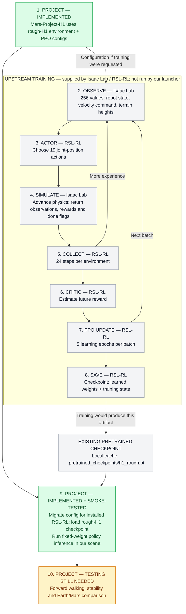

# Vision for Project: Mars-Project

Run one pretrained H1 walking policy on Earth and Mars, then compare outcomes.

## End goal

1. **Earth:** Walk straight for roughly 5–10 footsteps in the Poly Haven scene.
2. **Mars:** Run the same checkpoint with Mars gravity and, later, dust, reduced drag, and loose regolith.
3. **Findings:** Compare success over 100 trajectories per environment using the same target distance.
4. **Recording:** Save short videos for visual iteration, then produce final comparison footage.


## Training Pipeline

**This is a workflow map, not a checklist of training we have completed.** We reuse a pretrained
rough-H1 policy; this project has not run PPO training. Gray nodes describe functionality supplied by
Isaac Lab/RSL-RL. Green nodes are project integration verified by a smoke test. Amber means testing is still needed.



**“Matching task” means `Isaac-Velocity-Rough-H1`**, the upstream Isaac Lab velocity-tracking task
for Unitree H1 on rough terrain. Our registered task remains `Mars-Project-H1`: `MarsH1EnvCfg` inherits
`H1RoughEnvCfg`, and `MarsH1PPORunnerCfg` inherits `H1RoughPPORunnerCfg`. The actor takes 256 observations
(69 robot/command values plus 187 terrain heights) and outputs 19 joint actions; actor and critic use
`[512, 256, 128]` hidden layers. PPO inherits 24 steps per environment, 5 learning epochs, 4 minibatches
and a 0.001 learning rate. The experiment name remains `mars_h1`.

A **checkpoint** is a saved training snapshot containing learned neural-network weights and training state
(such as optimizer state and iteration). Loading its weights supplies the learned policy for playback.
Use a rough-H1 checkpoint matching this observation/action layout and network architecture; the cached
flat-H1 checkpoint is incompatible. The rough checkpoint from the earlier temporary smoke test is now cached
at `.pretrained_checkpoints/h1_rough.pt` (local, ignored by Git).

**Playback reuses the operations in steps 2–4 with fixed weights.** Our launcher does not collect training
batches, update weights or save training checkpoints. It applies Isaac Lab's version-aware RSL-RL config
migration before creating the runner. Fixed USD scenes retain height sensing and disable generated-terrain
curriculum. Earth/Mars gravity and appearance are scene overrides, not separate policy tasks.

Step 9 verification covers loading and a short simulation run, **not stable walking**. The current command
is still zero velocity; without `--checkpoint`, the launcher sends zero actions instead of using a policy.


## Flowchart

`src/` holds the importable `mars_project` package. **`tasks/` defines the robot's learning/control environment**
(observations, actions, rewards and resets, mostly inherited from Isaac Lab). **`scenes/` configures its surroundings
and camera** and applies rendering settings. **`scene_runner.py` coordinates both and owns the simulation loop.**

Read downward in execution order. Blue boxes carry the main project logic; gray boxes are supporting steps.
Paths below are relative to `src/mars_project/`, except the launcher in `scripts/`.

```mermaid
flowchart TD
    entry["scripts/view_scene.py<br/>Run the command"]
    path["sys.path.insert(0, .../src)<br/>Tell Python to search src first for imports"]
    main["scene_runner.py → main()<br/>Read CLI options with parse_args()"]
    assets["assets/scene_paths.py → validate_assets()<br/>Check the selected scene's files"]
    task["tasks/__init__.py imports tasks/h1.py<br/>Register Mars-Project-H1 and its H1/PPO configs"]
    config["scene_runner.py → parse_env_cfg()<br/>Load the registered config; select gravity"]
    setup["scenes/setup.py → configure_preview()<br/>Zero velocity commands; disable pushes and observation noise"]
    scene["scenes/earth.py OR scenes/canyon.py<br/>configure_earth_scene() / configure_canyon_scene()<br/>Configure scenery, collision ground, lighting and view"]
    launch["scene_runner.py<br/>launch_simulation() starts the simulator<br/>gym.make() builds the configured environment"]
    finish["scenes/earth.py OR scenes/canyon.py<br/>Apply render settings and verify scene setup"]
    camera["scene_runner.py → env.reset()<br/>scenes/cameras.py → create_camera()<br/>Select the fixed viewport camera"]
    policy["scene_runner.py<br/>If --checkpoint: load RSL-RL inference policy<br/>Otherwise: use zero actions"]
    loop{"scene_runner.py<br/>Simulator running and below --steps limit?"}
    step["scene_runner.py → action_step()<br/>Policy turns observations into actions, or use zeros<br/>env.step(actions) advances the environment<br/>Keep new observations; reset policy state for ended episodes"]
    close["scene_runner.py → env.close()<br/>Exit simulator context"]

    entry --> path --> main --> assets --> task --> config --> setup --> scene
    scene --> launch --> finish --> camera --> policy --> loop
    loop -->|Yes| step
    step -->|Increment step counter| loop
    loop -->|No| close

    classDef core fill:#dbeafe,stroke:#2563eb,color:#172554;
    classDef support fill:#f3f4f6,stroke:#9ca3af,color:#111827;
    class main,task,config,setup,scene,launch,finish,policy,loop,step core;
    class entry,path,assets,camera,close support;
```



`sys.path.insert` does not start the simulator or copy files: it makes `src/mars_project` discoverable by Python.
`from mars_project.scene_runner import main` loads that module and makes its `main` function available;
the launcher's `main()` call then starts the sequence above. Importing `tasks` also registers the task name with Gym.

The arrows show execution order, not that each file calls the next directly: **`main()` calls the helpers and resumes
when each returns**. `configure_preview()` itself calls the selected scene's configuration function. The nested
`action_step()` function runs only when the loop calls it; Isaac Lab's `env.step()` handles the underlying physics,
observations, rewards and episode resets. The project runner does not implement those mechanics itself.

## Current state

Cleanup is complete. **Walking stability is not yet verified. MP4 recording is implemented.**
Green = code/assets present, amber = blocked or needs verification, blue = implementation still needed.

```mermaid
flowchart TD
    base["1. PRESENT: H1 task + simulator runner<br/>Inherited observations, actions, rewards and resets<br/>Preview disables pushes and observation noise"]
    earth["2. EARTH: scene + collision ground + lighting present<br/>RESTORED: all 128 texture LFS pointers hydrated and verified<br/>Verify rendered sky and ground contact"]
    mars["2. MARS: canyon + rigid collision mesh + lighting present<br/>Gravity selectable: Earth −9.81 / Mars −3.71 m/s²"]
    camera["3. PRESENT: scene finishing + one fixed camera<br/>Verify framing in a rendered run"]
    policy["4. IMPLEMENTED: rough-H1 checkpoint playback<br/>Version-aware loader migration; short smoke test passed<br/>Stable walking unverified; see Training Pipeline above"]
    loop["5. PRESENT: action_step() + env.step() loop<br/>Velocity commands currently zero<br/>--steps limits control steps; 0 runs until closed"]
    walk["6. ADD: constant forward command + reproducible start<br/>Zero lateral/yaw commands; disable standing sampling<br/>Control reset pose, velocity and randomization<br/>Use pretrained inference by default; no new training"]
    timing["7. ADD: 6 simulation-second limit using env.step_dt<br/>Stop on fall; avoid continuing through episode resets"]
    video["8. IMPLEMENTED: offscreen frame capture + H.264 MP4<br/>Save to outputs/recordings for download after SSH runs<br/>Verify motion and framing for each run"]
    iterate["9. NEXT MILESTONE: inspect first Earth walking clip<br/>Then repeat on Mars with the same checkpoint"]
    physics["10. LATER: Mars environmental physics<br/>Dust, reduced drag and loose regolith are absent"]
    evaluation["11. LATER: evaluation and exported results<br/>Define shared distance and success criteria<br/>Log distance, simulation time and falls<br/>Run 100 seeded trajectories per environment"]

    base --> earth
    base --> mars
    earth --> camera
    mars --> camera
    camera --> policy --> loop --> walk --> timing --> video --> iterate
    iterate --> physics --> evaluation

    classDef present fill:#dcfce7,stroke:#16a34a,color:#14532d;
    classDef verify fill:#fef3c7,stroke:#d97706,color:#78350f;
    classDef todo fill:#dbeafe,stroke:#2563eb,color:#172554;
    class base,mars,loop,video present;
    class earth,camera,policy verify;
    class walk,timing,iterate,physics,evaluation todo;
```



**Control steps ≠ footsteps.** Counting 5–10 footsteps requires contact-event logic; start with a 6-second clip.
The final comparison still needs a shared walking distance. MP4 clips are supported by `--record`; these previews still use zero commanded velocity.

## Cleanup performed

- Removed disconnected WASD controls and the separate stand-up training task.
- Removed the broken `play_mars.py` shortcut and redundant environment-listing wrapper; `scripts/view_scene.py` is the sole launcher.
- Removed robot POV, orbit controls and the unused Earth dome-orientation helper; retained active sky, exposure and lighting logic.
- Removed the offline canyon builder, original USDZ, intermediate preview mesh and anchor; kept optimized runtime assets and source/build metadata. Rebuilding from raw sources now requires restoring the builder and inputs from version history/source provenance.
- Removed outdated planning/architecture documents; this README describes the current structure and next work.
- Kept every texture referenced by the active USD scenes. Asset validation now checks referenced dependencies for missing files and LFS pointers before simulation startup.
- Kept the pretrained checkpoint cache locally and added it to `.gitignore`.

## Remaining implementation order

1. Checkpoint loading and short policy playback are verified. Inspect camera framing and ground contact during the first walking clip.
2. Add constant forward motion, reproducible resets, a 6-second limit and stop-on-fall behavior.
3. MP4 capture is implemented; inspect Earth policy clips and iterate on stability and framing.
4. Repeat with the same checkpoint on Mars; then add metrics, repeated trials and the extra environmental physics.

## Run the existing preview

Use the existing Isaac Sim environment from the project root:

```bash
/home/eddie/env_isaaclab/bin/python scripts/view_scene.py --appearance earth --steps 300
/home/eddie/env_isaaclab/bin/python scripts/view_scene.py --appearance grand-canyon --gravity mars --steps 300
```

These are stationary previews unless `--checkpoint /absolute/path/to/checkpoint.pt` is supplied;
even with a checkpoint the current velocity command is zero. They use a Kit viewport. Add `--record LABEL --kit_args=--no-window` for offscreen recording over SSH. `--steps 300` means 300 control steps, not 300 footsteps or a guaranteed video duration.

Run the cached rough-H1 policy (zero commanded velocity, five control steps):

```bash
/home/eddie/env_isaaclab/bin/python scripts/view_scene.py --appearance earth --steps 5 --checkpoint .pretrained_checkpoints/h1_rough.pt --kit_args=--no-window
```

Restore missing LFS content from a configured remote with `git lfs pull`, or use `git lfs checkout` when the objects
are already cached. Validation reports missing/unhydrated assets before launching the simulator.

On 2026-11-12, restored all 128 Earth texture placeholders from the local LFS cache. All 136 tracked LFS
assets match their recorded sizes and SHA-256 hashes; Earth and canyon dependency validation and all three
tests pass. Rendered appearance, ground contact and walking stability still require a simulator smoke run.

## Project structure

```text
scripts/view_scene.py             Single CLI entry point
src/mars_project/
  scene_runner.py                CLI, simulator lifecycle, checkpoint inference and stepping
  tasks/h1.py                    H1 environment/PPO configuration and Gym registration
  scenes/setup.py                Stationary preview configuration and scene selection
  scenes/earth.py                Earth geometry, lighting and rendering settings
  scenes/canyon.py               Canyon geometry, collision and lighting
  scenes/cameras.py              One fixed camera
  assets/scene_paths.py          Runtime paths and USD dependency validation
  assets/data/                  Packaged runtime assets and provenance
tests/                          Registration and asset-validation checks
```

`h1.py` defines **what environment the policy controls**. `scene_runner.py` defines **how to launch and step it**.
Both are needed; there is no second stand-up task or keyboard-control module.

## Environment and checks

`pyproject.toml` and `uv.lock` describe the environment and editable Isaac Lab dependencies under
`/home/eddie/IsaacLab`. Update `[tool.uv.sources]` if that checkout moves. `uv sync` defaults to Newton;
this project's scene runner explicitly uses Isaac Sim PhysX and Kit, available in the existing interpreter above.
The optional dependency extras remain available for Isaac Lab compatibility.

```bash
.venv/bin/python -m pytest -q
```

The tests check registration and asset validation; they do not establish walking stability or rendering correctness.

## Render screenshots

Save a PNG at the viewport render resolution (opens in macOS Preview), grouped into Vancouver-date folders with 12-hour time and a descriptive label in its filename:

```bash
/home/eddie/env_isaaclab/bin/python scripts/view_scene.py --appearance grand-canyon --steps 1 --screenshot --screenshot-requested --kit_args=--no-window
```

Screenshots are opt-in: normal runs capture nothing. The command above runs one control step, followed by
60 render-only warmup frames and capture. `--screenshot` requires a positive `--steps` limit.
Use `--screenshot earth-restored` to choose a label; the default label is the scene appearance.
For explicitly requested captures, add `--screenshot-requested`. Files go to `outputs/recordings/MM-DD-YYYY/h:mmam_label.png` using an underscore before the label,
for example `11-12-2026/8:21pm_earth-restored.png`. Repeated labels within the same minute receive `-2`, `-3`, etc.
Use `--appearance earth`, `--steps N`, or `--checkpoint /path/to/policy.pt` to override preview settings.
The no-window option still requires an NVIDIA GPU and the Kit renderer; it captures the rendered viewport, not the desktop UI.
The canyon uses our generated orange sky/sun texture; the separate directional light supplies shadows.

Capture two policy-playback frames one simulation second apart (same camera framing):

```bash
/home/eddie/env_isaaclab/bin/python scripts/view_scene.py --appearance earth --steps 50 --checkpoint .pretrained_checkpoints/h1_rough.pt --screenshot-pair earth-test --screenshot-requested --kit_args=--no-window
```

A is captured after 50 control steps (1 simulation second), B after another 50 steps.
Render warmup does not advance physics. Files are saved under `outputs/recordings/MM-DD-YYYY/earth-test/`
as `h:mmam_earth-test-A.png` and `h:mmam_earth-test-B.png` (using the actual capture time).
The policy still receives a zero velocity command.

### Camera and lighting troubleshooting

**Symptom (2026-11-13):** intermittent near-black robot/ground in Earth recordings,
including `earth-6`, despite unchanged HDR assets and neutral exposure. Do not accept
such a recording as merely a dark scene. Inspect a rendered frame before delivering it.

**Leading suspected cause:** a loading/startup timing error: rendering or camera
activation may occur before assets and lighting/view settings are fully consumed by
RTX. Eddie flagged this on 2026-11-13. Treat loading synchronization and initialization
order as the first investigation path if it recurs; the exact mechanism is unconfirmed.

**Earlier workaround:** the `cd5998a` refactor removed initial-view settings. Commit
`b062fba` restored them and inserted three render updates before reset. This produced
both bright and dark runs and did **not** establish a permanent fix. Identical authored
settings in bright/dark runs do not prove that RTX has consumed them correctly.

**Startup hardening:** configure synchronous USD/material loading and Earth renderer
settings before `gym.make()` loads the scene. Configure the initial view as before.
Author the final camera's exposure and the render product's settings **before** calling
`set_active_camera()`, then render three updates without advancing physics. Author
`omni:rtx:lights:dome:samplingStrategy = imageBasedLighting` on the render product,
using `OmniRtxSettingsCommonAdvancedAPI_1`, as well as the legacy Carb setting.
Each launch prints a `RENDER_VIEW` JSON snapshot of the selected camera, exposure,
auto-exposure, renderer, HDR sampling and tonemapper for comparison.

**Evidence and limits:** controlled captures at one frozen robot pose showed that
lowering the camera to the body midpoint preserves correct illumination. Reapplying
settings and hiding/restoring the camera-sky dome did not establish a cure for the
intermittent fault. The precise internal RTX race is unconfirmed; the changes above
remove late/default configuration windows rather than compensate with brighter lights.
Preserve HDR light intensity/exposure, the two dome assets and ACES. Camera-height
changes alone must not alter any of those values. Fixed captures and orbits use the
measured body midpoint height; the orbit follows a smoothed body midpoint throughout movement.

Investigation logs: `outputs/log/lighting-investigation-zaMBMW.log`,
`outputs/log/lighting-height-investigation-5dh4Gu.log`, and
`outputs/log/lighting-startup-investigation-TuAHZm.log`. The original failed recording's
log is `outputs/log/earth-6-level-camera-6ZhE5T.log`; keep it and the original video.
Diagnostic stills are under `outputs/recordings/11-13-2026/misc/` with `lighting-diag`
in their names. `tests/test_camera_settings.py` checks stale exposure/sampling overrides
and lens preservation, but does not replace fresh-process rendered verification.

Verification after hardening: the six-second `earth-6/2:03pm_earth-6-orbit.mp4` and a
second fresh-process one-second `misc/2:05pm_lighting-startup-repeat-orbit.mp4` both
rendered with illuminated ground and visible robot surfaces. Inspected frames at 0,
3 and 5 seconds in the full recording, and 0.5 seconds in the repeat. Logs:
`outputs/log/earth-6-lighting-startup-fixed-d33Y7U.log` and
`outputs/log/lighting-startup-repeat-YwwKHi.log`. Four camera/asset regression tests
and Ruff checks passed. These runs support the mitigation, not proof that every
possible RTX startup failure is eliminated.

Recurrence: the first fixed-camera `earth-7` forward-walking run on 2026-11-13
was dark despite the startup hardening (`outputs/log/earth-7-forward-walk-5EWy7v.log`).
The walking command remained `[0.5, 0, 0]` for six seconds with zero resets.
Treat the lighting issue as unresolved/intermittent, not permanently fixed; retain
the failed capture and inspect fresh-run retries before delivery.
An unchanged fresh-process retry rendered correctly (`earth-7/2:15pm_earth-7.mp4`,
log `outputs/log/earth-7-forward-walk-retry-9ItJ8q.log`), further supporting a timing-dependent fault.

For future changes, run at least two fresh launches, compare the robot and ground in
rendered captures, and retain separate logs. If darkness recurs, record the effective
view state and compare fixed-pose renders before/after a single change; do not declare
another fixed-frame delay a proven fix or silently raise exposure.

Screenshot organization: captures made for diagnostics or verification without an explicit user request
must go in `outputs/recordings/MM-DD-YYYY/misc/`. This is the default for both single captures and
pairs, including Python calls to `capture_screenshot()`. Use `--screenshot-requested` (Python:
`requested=True`) only when the user explicitly asks for screenshots. Requested pairs use their label
folder; diagnostic pairs both go directly in `misc/`. Date, timestamp, labels and collision avoidance
work the same in either destination. A request to diagnose or fix something is not itself a request
for screenshots.

## Output organization

- `outputs/log/`: all `.log` files from runs, smoke checks and diagnostics.
- `outputs/lighting/`: standalone lighting comparisons, sky images and render PNG assets.
- `outputs/recordings/MM-DD-YYYY/`: screenshot-pipeline captures; unsolicited diagnostic captures go in `misc/`, while explicitly requested captures retain their requested grouping.

Keep the `outputs/` root free of loose logs and PNG files. These conventions are also recorded in
`AGENTS.md` for future work. For example, run a policy smoke check with its log in the correct folder:

```bash
mkdir -p outputs/log
/home/eddie/env_isaaclab/bin/python scripts/view_scene.py --appearance earth --steps 5 --checkpoint .pretrained_checkpoints/h1_rough.pt --kit_args=--no-window > "outputs/log/earth-playback-$(date +%Y%m%d-%H%M%S-%N).log" 2>&1
```

For five requested policy captures at simulation seconds 1–5, labeled A–E, use:

```bash
/home/eddie/env_isaaclab/bin/python scripts/view_scene.py --appearance earth --steps 50 --checkpoint .pretrained_checkpoints/h1_rough.pt --screenshot-series earth-test-2 --screenshot-count 5 --screenshot-requested --kit_args=--no-window
```

The series keeps the first capture's camera framing. Rendering pauses physics between captures;
the interval is simulation time. The normal environment reset behavior still applies.

## Record an MP4 over SSH

Install the encoder helper in the Isaac Sim interpreter once:

```bash
uv pip install --python /home/eddie/env_isaaclab/bin/python imageio-ffmpeg
```

Record five simulation seconds (250 control steps) as a single 1080p, 25-fps H.264 MP4:

```bash
/home/eddie/env_isaaclab/bin/python scripts/view_scene.py --appearance earth --steps 250 --checkpoint .pretrained_checkpoints/h1_rough.pt --record earth-test-3 --capture-requested --kit_args=--no-window
```

`--capture-requested` is an alias for `--screenshot-requested`. Requested videos go in
`outputs/recordings/MM-DD-YYYY/earth-test-3/`; unrequested videos go in the date's `misc/` folder.
All previous screenshot folders were moved from `outputs/screenshots` to `outputs/recordings`.
MP4 uses H.264 with `yuv420p` and fast-start metadata for Mac playback. Download the file to the Mac
(or copy it with `scp` from a Mac terminal) and open it in QuickTime. SSH itself does not stream a GUI.
Frames use a fixed camera, with physics paused during render/capture work. Temporary PNG frames are
removed after encoding. The policy receives zero velocity by default; normal automatic episode resets
remain enabled, so the clip is a preview rather than a continuous successful-walking trial.

For six seconds of forward walking (`0.5 m/s` in the robot's body frame):

```bash
/home/eddie/env_isaaclab/bin/python scripts/view_scene.py --appearance earth --steps 300 --checkpoint .pretrained_checkpoints/h1_rough.pt --forward-velocity 0.5 --record earth-7 --capture-requested --kit_args=--no-window
```

The same velocity-conditioned checkpoint handles standing and walking. `--forward-velocity`
sets a constant forward command, disables random standing selection, and keeps lateral/yaw
commands zero. The fixed-camera run records all 300 control steps without an extra settling
second. `WALK_PROGRESS` logs the command, position and cumulative resets each simulation second.

## Earth policy instability diagnosis (2026-11-13)

`earth-test-3` was a five-second **zero-command standing preview**, not five footsteps. Five control
steps in the original loader smoke check meant just 0.1 simulation seconds. That check established
loading/execution, not policy stability.

The Earth collision floor was authored as one USD quad. PhysX accepted it, but the installed Isaac Lab
height ray caster passes face indices directly to Warp's triangle mesh without triangulating USD
polygons. This left incomplete sensor ground coverage; missed heights became clipped -1 observations.
The rough-H1 policy therefore received false terrain information. The floor now uses two triangles
with the same vertices and physical footprint. A regression test checks triangular topology and coverage.

A seed-42 comparison using the same checkpoint, zero commands and inherited reset settings produced
five terminations/automatic respawns in 250 control steps with the quad, versus zero with triangulation.
The corrected test had 187/187 finite height rays at each sampled check and roughly 0.28 m horizontal
drift over five seconds. Logs: `outputs/log/policy-standing-baseline.log` and
`outputs/log/policy-standing-triangulated.log`. This is a short diagnostic result, not validation across
seeds or walking commands. At the time of that diagnostic, random starting velocities/yaw and mass randomization remained inherited;
automatic resets can make a failed preview appear to jump back upright. Earth now has a reproducible standing setup; stop-on-fall behavior remains work to do. Existing videos show the pre-fix behavior.

For a cinematic six-second orbit saved alongside an existing test's video:

```bash
/home/eddie/env_isaaclab/bin/python scripts/view_scene.py --appearance earth --steps 300 --checkpoint .pretrained_checkpoints/h1_rough.pt --record earth-test-4 --camera-motion orbit --capture-requested --kit_args=--no-window
```

Orbit mode lets the policy settle for one unrecorded simulation second, then captures an 80-degree fly-by arc (the trail's rocks and tree obstruct a full revolution)
with eased camera speed and a level view at the robot's measured midpoint height. The MP4 has an `-orbit` filename
suffix and stays in the test's folder. Fixed-camera recording remains the default.

Earth outward-facing setup: spawn is fixed at `(0, 0, 1.05)` with zero root/joint velocities,
fixed default joint positions, seed 42, and no torso-mass randomization. The source scene camera
is on the outward trail at approximately `(0.0725, -6.6968)` in world XY. Facing from the spawn toward
that landmark gives yaw `atan2(-6.6968, 0.0725) = -89.38 degrees`, with the cave behind the robot.
Initial orientation is XYZW identity before the yaw reset; this Isaac Lab build uses XYZW quaternions.

The orbit starts at the robot's measured midpoint after settling, with the source camera
position establishing its starting azimuth. Each frame filters the body midpoint before translating and aiming the orbit.
Two cascaded filters use 0.12-second horizontal and 0.4-second vertical time constants
to suppress footstep bounce. Both camera position and aim use the filtered target;
the robot can bob naturally within the frame instead of shaking the whole view.
Robot heading does not rotate the camera arc. The same 80-degree
arc, radius 2.6 m and 22 mm lens are used every run. Each launch logs the actual initial position,
quaternion and six velocity components for verification. This establishes a reproducible reference;
the earlier unseeded videos cannot be reproduced exactly from their MP4s alone.


Earth-8 uses a local collision mesh sampled from the visible trail substrate
(`Mesh_0095`), replacing the former flat floor. The crop is world X [-2, 2] m,
Y [-5, 1.5] m: the outward walking corridor plus footstep and height-scanner margin.
The 5 cm grid contains 10,611 vertices and 20,800 triangles. Physics and the rough-H1
height scanner both use this single invisible mesh. The remaining scenery has no
collision cost; foliage, separate rocks, and overhangs are excluded. This is a rigid
terrain approximation, not deformable soil or a calibrated regolith slip model.
Rebuild with `.venv/bin/python scripts/build_earth_collision.py`; source/crop metadata
is saved beside `earth_collision_ground.usda`. Forward-walking runs check for missing
height rays each simulation second and stop if the scanner leaves the patch.
Longer routes require extending the crop before recording.

```bash
mkdir -p outputs/log
/home/eddie/env_isaaclab/bin/python scripts/view_scene.py --appearance earth --steps 300 --checkpoint .pretrained_checkpoints/h1_rough.pt --forward-velocity 0.5 --record earth-8 --camera-motion orbit --capture-requested --kit_args=--no-window > "outputs/log/earth-8-$(date +%Y%m%d-%H%M%S-%N).log" 2>&1
```

This records six seconds at 25 fps after one second of policy settling, retaining the
80-degree eased arc, 2.6 m radius and 22 mm lens while following the moving robot.
