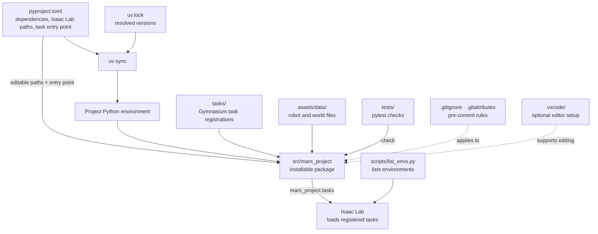
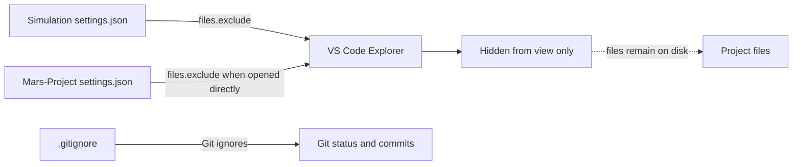
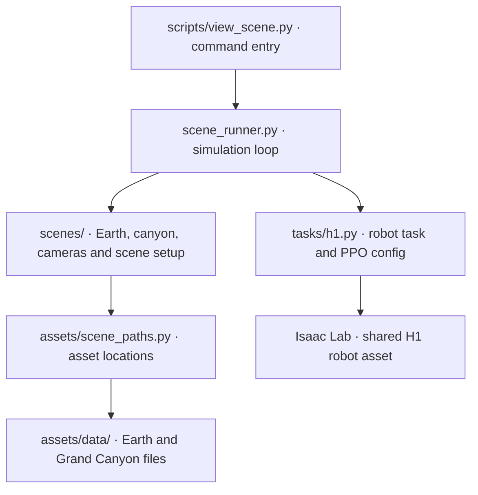

# Mars-Project map

## How the pieces connect



## Project files

```text
Mars-Project/
├── src/mars_project/                 # Importable Isaac Lab extension.
│   ├── __init__.py                   # Package marker.
│   ├── assets/
│   │   ├── __init__.py               # Defines the stable asset-data path.
│   │   ├── scene_paths.py            # Asset paths and validation.
│   │   └── data/                     # Earth and Grand Canyon assets.
│   ├── scene_runner.py               # Owns the simulation loop.
│   ├── scenes/                       # Scenery, camera and preview setup.
│   └── tasks/
│       ├── __init__.py               # Loads project task modules.
│       └── h1.py                     # H1 task, registration and PPO config.
├── tests/
│   └── test_registration.py          # Checks task-registration entry points.
├── scripts/
│   ├── list_envs.py                  # Lists registered environments.
│   └── view_scene.py                 # Launches the scene viewer.
├── docs/
│   ├── architecture.md               # This project map.
│   └── plan.md                       # Mars locomotion and training plan.
├── .vscode/                          # Optional editor setup and templates.
├── pyproject.toml                    # Package metadata, dependencies, paths, and tool settings.
├── uv.lock                           # Resolved dependency versions for uv.
├── README.md                         # Setup and usage instructions.
├── LICENSE                           # Project license terms.
├── .gitignore                        # Excludes local environments, caches, and outputs from Git.
├── .gitattributes                    # Git LFS and file handling rules.
└── .pre-commit-config.yaml           # Checks that run before commits.
```

## What VS Code hides

I found VS Code `settings.json` files rather than a `workspace.json`:

- [`../.vscode/settings.json`](../../.vscode/settings.json) is the Simulation workspace setting. It hides `.git`, `.venv`, caches, `.vscode`, `.gitattributes`, `.gitignore`, `.pre-commit-config.yaml`, `LICENSE`, `README.md`, `architecture.md`, and `plan.md`. It explicitly keeps `pyproject.toml` and `uv.lock` visible.
- [`.vscode/settings.json`](../.vscode/settings.json) applies when Mars-Project itself is opened as the workspace. It hides the same general setup and cache files, and also hides `pyproject.toml` and `uv.lock`.

These `files.exclude` rules only hide items in the VS Code Explorer. They do not delete files, change Python imports, or determine what Git commits.



**Current state:** `Mars-Project-H1` is registered locally. Earth and Grand Canyon assets live inside this project. Isaac Lab and Isaac Sim remain dependencies, but the sibling Mars Locomotion checkout is no longer used.

## Scene viewer



Run with the existing Isaac Sim interpreter from the project root:

```bash
/home/eddie/env_isaaclab/bin/python scripts/view_scene.py --appearance earth
/home/eddie/env_isaaclab/bin/python scripts/view_scene.py --appearance grand-canyon
```
