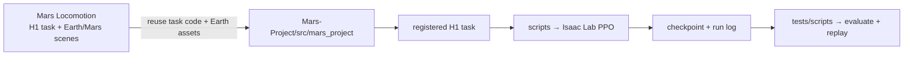
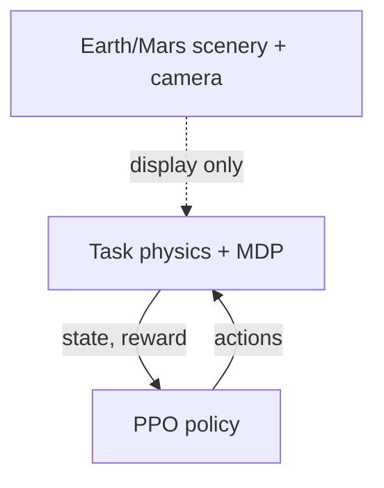

# Mars locomotion → training

## Keep each part focused

| Place | Owns |
|---|---|
| `src/mars_project/tasks/` | H1, observations, actions, rewards, resets, gravity |
| `src/mars_project/assets/data/` | Earth/Mars USD and textures |
| `scripts/` | train, preview, evaluate |
| `tests/` | registration, config, short smoke checks |

## Today

1. Reuse `Mars-Locomotion-H1` task and PPO config.
2. Add its registration to `mars_project`; keep Earth/Mars gravity selectable.
3. Copy/package Earth assets; preserve separate visible scene and collision ground.
4. Train on flat ground first; scenery stays preview-only.
5. Register → dry run → short smoke run → start training.

**Current:** Mars-Project is a skeleton; Mars Locomotion has the H1 task, launchers, and Earth/Mars scenes. Earth scene setup is currently preview-only. No task is registered in Mars-Project yet.
